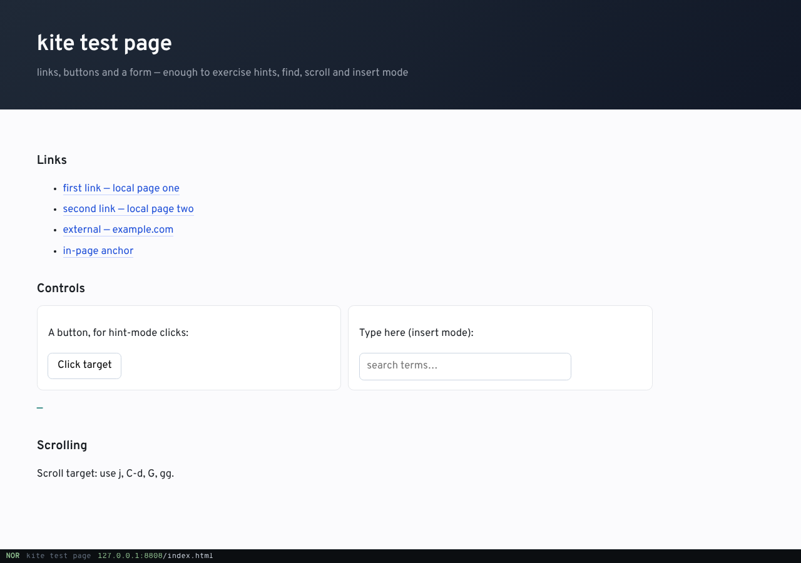
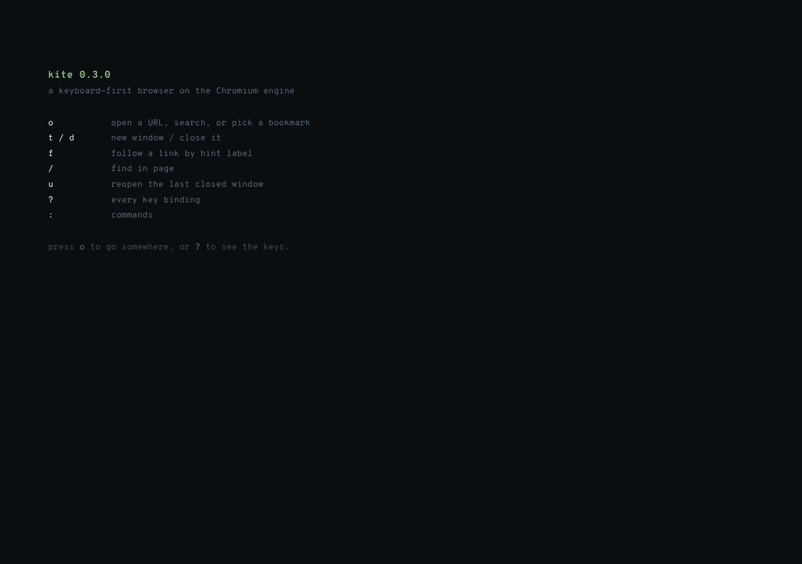
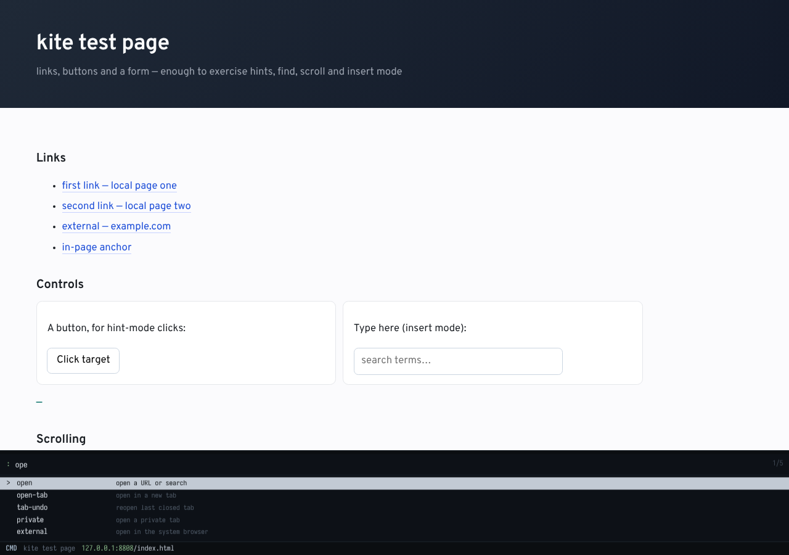

# kite

A keyboard-first browser shell that uses **Chromium as its engine** and adds
almost nothing on top.

kite is a proof of concept for a specific question: *what does a qutebrowser-like
browser look like if you delete the Python and the Qt, keep the Chromium engine,
and make the chrome as cheap as a text field?* The target machine is a slow ARM
board with a keyboard — not a workstation.

The chrome is one status line at the bottom of the page, drawn in monospace on a
grid, in the spirit of a terminal UI: no rounded cards, no shadows, no browser
toolbar, and no window frame.



## The short version

| | qutebrowser | kite |
| --- | --- | --- |
| Engine | QtWebEngine (Chromium, embedded) | system Chromium, separate process |
| Shell | Python + Qt | Rust, one 857 KB binary |
| Keys | Qt event → Python command registry | Chromium key path → one JS handler |
| UI | Qt widgets | shadow-DOM overlay: one bottom status line |
| NixOS | package | package + flake + `programs.kite` module |

The shell never embeds the engine. It launches Chromium, speaks the Chrome
DevTools Protocol over a local socket, and owns the things a browser shell owns:
tabs, navigation, history, bookmarks, session restore, config, clipboard.

That decision is what makes it portable to ARM and cheap on RAM: there is no CEF
to build, no Qt to link, no Python to start, and no second compositor.

## How it works

```
┌──────────────────────────────┐        ┌─────────────────────────────────┐
│ kite  (Rust, ~1 MB binary)   │        │ chromium (system package)       │
│                              │  CDP   │                                 │
│  tabs / targets              │◄──────►│  window ⇄ renderers             │
│  history · bookmarks · state │ ws://  │  page + injected UI layer       │
│  config · completions        │        │                                 │
│  clipboard · session         │        │  ↑ the page is the UI surface   │
└──────────────────────────────┘        └─────────────────────────────────┘
              ▲                                        ▲
              └──── binding calls (only for privileged work) ────┘
```

The UI layer is a script injected into the top frame of every document. It draws
the bar, the palette, hint labels and the help overlay inside a closed shadow
root, and it owns the keymap. Keys are handled **in the page**, on Chromium's
normal input path: no IPC, no synthetic events, no focus stealing. Anything that
needs privilege (open a tab, save a bookmark, write the clipboard, quit) crosses
the binding to Rust.

Two consequences worth stating plainly:

- **Keystroke latency is the engine's own.** There is no interpreter between a
  key and the action.
- **It works the same on Wayland.** A separate native UI process cannot take the
  keyboard from the engine's window on Wayland — that is unsolvable by design —
  so moving the chrome *into* the page is not a compromise, it is the only
  correct shape.

The UI layer does not run in the page's world. It lives in a CDP **isolated
world** (`Page.createIsolatedWorld`, world name `kite`), with its own
`window`, its own globals and its own copy of the DOM. The `__kiteSend` binding
is registered for that context name only, so a page cannot see `window.__kite`,
cannot call the binding, and cannot overwrite the key handler. The world belongs
to a document, so kite rebuilds it on every navigation and re-injects the layer
there; `--selftest` asserts the page side stays `undefined/undefined` after a
navigation, not just on the first document.

Dialogs follow the same rule — a page never gets a free "yes":

```toml
[general]
dialogs = "block"   # alert/beforeunload accepted; confirm/prompt denied + toast
                    # "allow" accepts everything, for sites you trust
```

## No Chromium UI, no window frame

Chromium is the engine, not the interface. Three things keep its own chrome out
of the way:

- **App mode, always.** Every window is created with `--app=<url>`, which gives a
  single page with no tab strip, no omnibox and no toolbar. Two details matter:
  Chromium silently refuses `--app=about:blank` and opens a *full browser
  window* instead, so kite boots on a dark `data:` placeholder and navigates from
  there; and `Target.createTarget` always builds a tabbed browser window, so new
  tabs ask the live browser for another app window instead.
- **No title bar.** With `decorations = false` (the default) kite asks Chromium
  for an undecorated surface on Wayland, and strips the window-manager frame on
  X11 with the Motif hint (`_MOTIF_WM_HINTS` via `xdotool` + `xprop`, re-applied
  to each new tab). Compositors like niri and sway draw no server-side
  decorations at all, so the page fills its tile edge to edge.
- **A way out.** `fullscreen = true` (or `kite --fullscreen`) starts the window
  fullscreen, which removes every frame on every compositor, including ones that
  ignore Motif hints (GNOME). `kite --decorated` restores a normal window.

```toml
[general]
decorations = false   # no title bar / borders
fullscreen = false    # start fullscreen instead
```

On Wayland the frame is the compositor's business; kite cannot override a
compositor that insists on drawing one. If a border or gap remains, the rule
belongs in the compositor config (for example niri's `border { off }` window
rule, or sway's `default_border none`).

## The start page

There is a built-in `kite:home` page, and it is a file, not a server and not a
`data:` URL: kite writes it to `<state>/home.html` at startup (rewritten when the
contents change) and boots the first window on it. That keeps the address short
and readable in the status line and in the session file, works offline, and
costs one `write` per upgrade. It follows `general.font` and the release version.

`start_page = "home"` (the default) is what makes `o`, `gh` and a new window land
there; set it to a URL if you would rather boot somewhere else.



## What works (verified)

Checked by driving a real Chromium under a real X server (`dev/harness.sh`):

- **Navigation** — `o`/`O` open, palette with fuzzy completion, `H`/`L` back and
  forward, `r`/`R` reload, `gh` home. Verified: `o` → typed URL → Enter → page loaded.
- **Hint mode** — `f` labels every visible link, button and input; type the label
  to click. `F` opens in a new tab, `;y` yanks the link. Verified: labels render
  over the right elements, `HNT` chip shown.
- **Command palette** — `:` with fuzzy matching over commands, and separate
  palettes for history, bookmarks, tabs and search engines. Verified: `ope` lists
  `open`, `open-tab`, `tab-undo`, `private`, `external`.
- **Tabs** — `t`, `d`, `gt`/`gT`, `g1`/`g9`, `u` (reopen closed). Verified:
  creating, switching and closing change the model correctly, and a new tab is
  an app window with no Chromium chrome.
- **Window chrome** — no title bar, no tab strip, no toolbar. Verified under
  Xvfb + i3 (the WM frame is stripped) and by the Wayland decoration and
  `--app=` behaviour in `WAYLAND_DEBUG` logs.
- **Insert mode** — typing in a field switches automatically; `Esc` returns to
  normal. Verified: `gi` focuses the first input and the chip turns green `INS`.
- **Scrolling** — `j`/`k`, `C-d`/`C-u`, `C-f`/`C-b`, `gg`/`G`, counts. Verified:
  `j` moved 84 px, `5 j` moved 420 px, `G` jumped to the bottom.
- **Find** — `/`, `n`/`N`.
- **Yank/paste** — `yy` URL, `yt` title, `p`/`P` paste-and-open.
- **Zoom** — `+`/`-`/`C-0`.
- **Bookmarks & history** — `m`, `gb`, `C-h`, persisted as JSON, used as palette
  sources and ranked by a cheap frecency score.
- **Session restore** — tabs come back on restart, as app windows (no tab strip).
- **Reopen a closed window** — `u` after a window closes, and the closed stack is
  written to `closed.json`, so the last window can be brought back on the next
  launch too. Verified with two windows: close one, `u`, it returns; quit from
  the last one, relaunch, it comes back.
- **Dialogs** — `confirm`/`prompt` are blocked by default and surfaced as a
  toast; `alert`/`beforeunload` are dismissed so a page cannot hang the window.
- **Config keys that do something** — `javascript = false` disables page scripts
  (`Emulation.setScriptExecutionDisabled`), `images = false` strips images,
  `status = false` hides the status line, `font` sets the UI stack, `dialogs`,
  `bar`, `start_page`, `decorations`, `fullscreen`.
- **Private tabs** — CDP browser contexts.
- **Extensions** — unpacked addons load into app windows; `:extensions` opens
  their own pages. Verified: a content script blocks a real ad request, and an
  extension keyboard command fires.
- **Config** — TOML, deep-merged over built-in defaults, hot-reloadable by
  restart; on NixOS you can generate it declaratively.
- **Help** — `?` renders the full keymap from the live config.

Still missing or partial: downloads have a directory but no UI, no permission
prompts (camera/mic/notifications), find has no match counter, no reader mode, no
sync. Extensions load (see below) but have no browser chrome to live in.

## Extensions

Chromium addons load into kite's app windows; kite just gives them no browser
chrome to live in. Point `general.extensions` at unpacked directories:

```toml
[general]
extensions = [
  "~/.local/share/kite/ext/ublock-origin-lite",
  "~/.local/share/kite/ext/keepassxc-browser",
]
```

kite turns that into `--load-extension=…` + `--disable-extensions-except=…`, and
`:extensions` lists what actually loaded (name, id, URL) so you can open an
addon's own page as a window — that is the only "toolbar" there is.

What works and what cannot, tested against real addons in an app window under
Xvfb:

| | |
| --- | --- |
| content scripts, MV3 service workers, declarativeNetRequest | ✅ verified: uBlock Origin Lite blocks the ad script it is there for |
| extension keyboard commands (`chrome.commands`) | ✅ verified: `Alt+Shift+K` in an app window reached the extension |
| extension pages (`chrome-extension://…/popup.html`, `dashboard.html`) | ✅ verified: they open in a normal kite window |
| toolbar button, badge, `chrome.action` popup | ❌ no toolbar exists; an addon that is *only* a button has nothing to click |
| `chrome://extensions` | ❌ Chromium refuses app mode and opens a full browser window instead |
| Chrome Web Store install | ❌ sideload unpacked directories only |
| startup cost | ⏱ two addons add ~4.5 s to engine start (9 MB of filter rules is not free) |

### uBlock Origin

The classic MV2 uBlock Origin **no longer loads** in current Chromium: it needs
manifest v2, and Chromium 157 refuses it even with
`--disable-features=ExtensionManifestV2Deprecation` (verified: no background
page, the ad script still loads). Use **uBlock Origin Lite** (MV3) instead —
[`uBOL-home` releases](https://github.com/uBlockOrigin/uBOL-home/releases),
`uBOLite_*.chromium.zip`, extracted to `~/.local/share/kite/ext/ublock-origin-lite`.
Its popup and its dashboard both open through `:extensions`.

### KeePassXC-Browser

The extension loads ([releases](https://github.com/keepassxreboot/keepassxc-browser/releases),
`keepassxc-browser_*_chromium.zip`), its service worker runs, and its fill
shortcuts (`Alt+Shift+U` / `Alt+Shift+P`) reach it. One thing has to be fixed
outside kite: KeePassXC's native-messaging host manifest only allows the
extension ids from the Chrome Web Store, while an unpacked copy gets a different
id (a hash of its directory). Add kite's id to `allowed_origins`:

```sh
# the id is in the :extensions palette (also in
# <state>/engine-profile/Default/Preferences, extensions.settings)
HOST=~/.config/chromium/NativeMessagingHosts/org.keepassxc.keepassxc_browser.json
python3 -c 'import json,sys;p=sys.argv[1];d=json.load(open(p));d["allowed_origins"].append("chrome-extension://"+sys.argv[2]+"/");json.dump(d,open(p,"w"),indent=4)' \
  "$HOST" <id-from-kite>
```

Then `Alt+Shift+U` on a login page asks KeePassXC to approve the new client, and
`:extensions` opens the popup where the connection state and per-site settings
live. Not verified end to end: the approval dialog and a real fill need the
database unlocked, which the headless harness cannot do — so treat that last
step as "should work, tell me if it does not".

Remember: a page still cannot touch the shell (the UI layer lives in its own
world), but an extension is privileged code by design — it can do what it
declares to every page you load.

## Install

```sh
nix run .                     # from a checkout
nix profile install .#kite
```

The package wraps `kite` with Chromium and the clipboard helpers on `PATH`, so
the engine needs no configuration.

### NixOS module

```nix
{
  # pin to wherever you keep the checkout
  inputs.kite.url = "path:/home/you/src/kite-browser";

  # in your configuration
  imports = [ inputs.kite.nixosModules.default ];

  programs.kite = {
    enable = true;
    defaultBrowser = true;          # handle http/https links
    engine = "chromium";            # chromium | ungoogled | chrome
    settings = {
      general.search_engine = "wikipedia";
      general.hints_chars = "jkl;asdf";
      keys.normal."<C-S-h>" = "history-list";
      search.nix = "https://search.nixos.org/packages?query={}";
    };
  };
}
```

Settings are written to `/etc/xdg/kite/config.toml`; the user's
`$XDG_CONFIG_HOME/kite/config.toml` still wins (it is merged on top).

### Without Nix

```sh
cargo build --release
./target/release/kite https://example.com
```

Requires a Chromium binary on `PATH` (or `--engine /path/to/chromium`). If user
namespaces are unavailable (containers, some CI), set `KITE_NO_SANDBOX=1`.

## Keys

Defaults, all remappable. `?` shows the live list.

| Key | Action |
| --- | --- |
| `j` `k` `h` `l` | scroll down/up/left/right |
| `Space` / `Backspace` | page down/up |
| `C-d` / `C-u` | half page |
| `gg` / `G` | top / bottom |
| `H` / `L` | back / forward |
| `r` / `R` | reload / hard reload |
| `o` / `O` / `go` | open / open new tab / edit current URL |
| `t` / `d` / `gt` / `gT` / `u` | new / close / next / prev / reopen window |
| `f` / `F` / `;y` | hint click / hint new tab / hint yank |
| `:` | command palette (`:extensions` lists loaded addons) |
| `/` `n` `N` | find, next, previous |
| `yy` `yt` | yank URL / title |
| `p` `P` | paste & open / paste & open new tab |
| `m` `gb` `C-h` | bookmark, bookmarks, history |
| `+` `-` `C-0` | zoom in/out/reset |
| `i` `Esc` | insert mode / back to normal |
| `v` | passthrough (page gets every key) |
| `ZQ` `ZZ` | quit |




## Performance

Measured on the machine this was developed on — 4 cores, 7.8 GB RAM, software
rasterisation under Xvfb, which is *slower* than the ARM boxes this targets
because there is no GPU acceleration at all. Method and full numbers in
[`docs/perf.md`](docs/perf.md); reproduce with `./dev/bench.sh`.

<!-- BENCH-TABLE -->
Cold start and shell memory, 3 runs each, median shown. Same tool, same box,
same page — `dev/bench.sh` and `dev/bench-qutebrowser.sh`:

| metric | kite | qutebrowser 3.7 (QtWebEngine) |
| --- | --- | --- |
| shell process RSS | **11 MB** | 140 MB |
| time from exec to a mapped window | **1.35 s** | 0.98 s* |
| processes in the browser tree | 9 (Chromium) | not captured* |
| total PSS, whole tree | 422 MB | not captured* |

\* The qutebrowser column was measured on an earlier 2-core box with
`dev/bench-qutebrowser.sh` and was **not** re-run here (it is not installed), so
the start-time row is not a same-box comparison — treat it as indicative and the
memory ratio, which is a language-and-toolkit difference, as the robust part.
Internally, kite reports engine-ready at ~1.5 s and first paint ~1.0 s after
that (`KITE_TIMING=1`); the window is mapped at 1.35 s.

What this does and does not show: the **shell** is roughly 12× lighter, which is
what deleting Python and Qt buys. The **page** costs the same, because it is the
same engine — 422 MB of PSS for nine Chromium processes running without GPU
acceleration is Chromium's bill, not kite's. Cold start is over a second on this
box and most of it is Chromium: kite's own work before the engine is up is a
config read and a socket.

The honest summary: **the shell is free, the engine is not.** kite's own process
stays around 11 MB no matter how many tabs are open, and keys never leave the
page. But a Chromium renderer costs what it costs, and no shell above it changes
that. If your slow machine struggles with Chromium pages, the fix is fewer
renderers (`--renderer-process-limit`, already set), a smaller V8 heap (already
set), and turning images off — not a different shell.

## Why not CEF, QtWebEngine, or Electron?

- **CEF** — you would build Chromium. Hours of compile time and 16 GB+ of RAM to
  start, on aarch64 you own the whole toolchain, and you inherit responsibility
  for security updates. Wrong tool for a shell.
- **QtWebEngine** — that is exactly qutebrowser's stack. You would rebuild the
  thing you are trying to beat, plus Qt.
- **WebKitGTK** — lighter, but not the Chromium engine, and its site
  compatibility is worse for the modern web.
- **Electron** — heavier than any of the above for a browser.

Running Chromium as a process and talking CDP gives the same engine with system
security updates, no build cost, and a shell that can be rewritten in an
afternoon.

## Known limitations

1. **Each tab is its own window.** Chromium's app windows hold one page each, so
   `t` asks the live browser for another app window. kite's status line lists all
   tabs and switching raises the right window, but your window manager will show
   several windows. A single-window multi-tab setup needs either Chromium's own
   tab strip (visible chrome) or engine embedding — both are deliberate
   trade-offs, not bugs. Private tabs still use a CDP browser context, which
   means they come back as a tabbed browser window.
2. **No permission prompts.** Camera, microphone and notification requests have
   no UI.
3. **No toolbar, so no addon UI.** Extensions can block, fill and run scripts;
   a toolbar button has nowhere to be clicked.
4. **Dialogs are all-or-nothing.** `dialogs = "block"` denies every `confirm`
   and `prompt`, so a site that needs one (a "discard draft?" prompt, a login
   flow) needs `dialogs = "allow"` for the whole session.
5. **One window per tab still.** Session restore goes through the same
   app-window path, so several restored tabs are several windows.
6. **Find is basic.** `window.find` selects text but has no highlight or count.
7. **`--disable-gpu` can blank pages** on some builds — off by default, see
   `docs/perf.md`.
8. **Quitting kills the engine.** Closing the last window exits; there is no tray
   or background mode. (The window itself is recoverable with `u`.)

Known Chromium leaks that kite deliberately keeps: private tabs come back as a
tabbed browser window, because a private context cannot adopt an app window.

## Development

```sh
nix develop          # rust, chromium, xvfb, i3, xdotool, imagemagick
cargo build --release

# real GUI test: Xvfb + i3 + a local test page, with screenshots
KITE_SCENARIO=basic   ./dev/harness.sh    # bar, scroll, hints
KITE_SCENARIO=palette ./dev/harness.sh    # command palette
KITE_SCENARIO=help    ./dev/harness.sh    # the keymap pager
KITE_SCENARIO=insert  ./dev/harness.sh    # auto insert mode
KITE_SCENARIO=nav     ./dev/harness.sh    # o → url → enter
KITE_SCENARIO=find    ./dev/harness.sh    # / → type → enter
KITE_SCENARIO=tabs    ./dev/harness.sh    # new windows
KITE_URL= KITE_SCENARIO=home  ./dev/harness.sh   # the built-in start page

# headless assertions (engine up, first paint, UI injected, keymap delivered)
./target/release/kite --selftest <url>
KITE_KEYS="f" ./target/release/kite --selftest <url>   # drive the keymap

# cold start + PSS memory, 3 runs
./dev/bench.sh /tmp/bench.jsonl

# fetch uBlock Origin Lite + KeePassXC-Browser as unpacked addons
./dev/extensions.sh
```

Unit tests (`config`, `store`, `home`, URL resolution) and the harness run in CI
on every push: `.github/workflows/ci.yml` does `cargo test`, a release build, and
the `basic` scenario under Xvfb + i3.

Useful environment switches: `KITE_NO_SANDBOX`, `KITE_DISABLE_GPU`,
`KITE_ENGINE_LOG`, `KITE_PRINT_ARGS`, `KITE_DEBUG_BIND`,
`KITE_NO_UI`, `KITE_TIMING`.

## Layout

```
src/ws.rs       minimal WebSocket client + debug-port HTTP (no async runtime)
src/cdp.rs      CDP client, flat sessions, event queue
src/engine.rs   Chromium supervisor, performance flags, extension args
src/shell.rs    tabs, navigation, privileged commands, completions, session
src/store.rs    history, bookmarks, session, closed windows (JSON, atomic writes)
src/home.rs     writes the built-in start page and hands back its file:// URL
src/config.rs   TOML defaults, deep merge, key-sequence normalisation
src/wm.rs       strips the X11 window frame from the engine's windows
src/ui.js       injected chrome: status line, palette, hints, keymap, help
src/home.html   the start page, embedded at build time
nix/            package, NixOS module, desktop entry, icon
dev/            headless GUI harness, benchmark, GPU probe, addon fetcher
```

## License

MIT.
