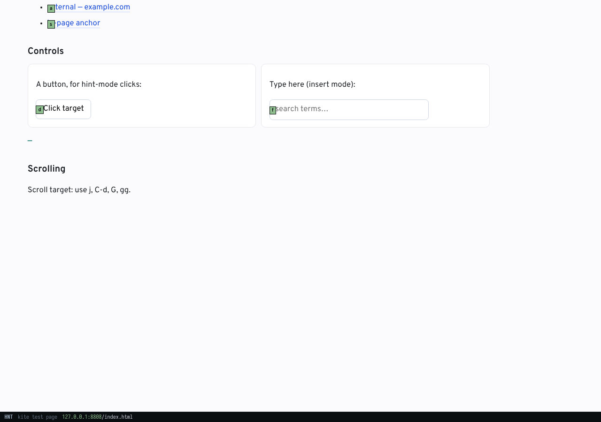

# kite

A keyboard-first browser shell that uses **Chromium as its engine** and adds
almost nothing on top.

kite is a proof of concept for a specific question: *what does a qutebrowser-like
browser look like if you delete the Python and the Qt, keep the Chromium engine,
and make the chrome as cheap as a text field?* The target machine is a slow ARM
board with a keyboard — not a workstation.

The chrome is one status line at the bottom of the page, drawn in monospace on a
grid, in the spirit of a terminal UI: no rounded cards, no shadows, no browser
toolbar, and no window frame.


## The short version

| | qutebrowser | kite |
| --- | --- | --- |
| Engine | QtWebEngine (Chromium, embedded) | system Chromium, separate process |
| Shell | Python + Qt | Rust, one 922 KB binary |
| Keys | Qt event → Python command registry | Chromium key path → one JS handler |
| UI | Qt widgets | shadow-DOM overlay: one bottom status line |
| NixOS | package | package + flake + `programs.kite` module |

The shell never embeds the engine. It launches Chromium, speaks the Chrome
DevTools Protocol over a local socket, and owns the things a browser shell owns:
tabs, navigation, history, bookmarks, session restore, config, clipboard.

That decision is what makes it portable to ARM and cheap on RAM: there is no CEF
to build, no Qt to link, no Python to start, and no second compositor.

## How it works

```
┌──────────────────────────────┐        ┌─────────────────────────────────┐
│ kite  (Rust, ~1 MB binary)   │        │ chromium (system package)       │
│                              │  CDP   │                                 │
│  tabs / targets              │◄──────►│  window ⇄ renderers             │
│  history · bookmarks · state │ ws://  │  page + injected UI layer       │
│  config · completions        │        │                                 │
│  clipboard · session         │        │  ↑ the page is the UI surface   │
└──────────────────────────────┘        └─────────────────────────────────┘
              ▲                                        ▲
              └──── binding calls (only for privileged work) ────┘
```

The UI layer is a script injected into the top frame of every document. It draws
the bar, the palette, hint labels and the help overlay inside a closed shadow
root, and it owns the keymap. Keys are handled **in the page**, on Chromium's
normal input path: no IPC, no synthetic events, no focus stealing. Anything that
needs privilege (open a tab, save a bookmark, write the clipboard, quit) crosses
the binding to Rust.

Two consequences worth stating plainly:

- **Keystroke latency is the engine's own.** There is no interpreter between a
  key and the action.
- **It works the same on Wayland.** A separate native UI process cannot take the
  keyboard from the engine's window on Wayland — that is unsolvable by design —
  so moving the chrome *into* the page is not a compromise, it is the only
  correct shape.

## No Chromium UI, no window frame

Chromium is the engine, not the interface. Three things keep its own chrome out
of the way:

- **App mode, always.** Every window is created with `--app=<url>`, which gives a
  single page with no tab strip, no omnibox and no toolbar. Two details matter:
  Chromium silently refuses `--app=about:blank` and opens a *full browser
  window* instead, so kite boots on a dark `data:` placeholder and navigates from
  there; and `Target.createTarget` always builds a tabbed browser window, so new
  tabs ask the live browser for another app window instead.
- **No title bar.** With `decorations = false` (the default) kite asks Chromium
  for an undecorated surface on Wayland, and strips the window-manager frame on
  X11 with the Motif hint (`_MOTIF_WM_HINTS` via `xdotool` + `xprop`, re-applied
  to each new tab). Compositors like niri and sway draw no server-side
  decorations at all, so the page fills its tile edge to edge.
- **A way out.** `fullscreen = true` (or `kite --fullscreen`) starts the window
  fullscreen, which removes every frame on every compositor, including ones that
  ignore Motif hints (GNOME). `kite --decorated` restores a normal window.

```toml
[general]
decorations = false   # no title bar / borders
fullscreen = false    # start fullscreen instead
```

On Wayland the frame is the compositor's business; kite cannot override a
compositor that insists on drawing one. If a border or gap remains, the rule
belongs in the compositor config (for example niri's `border { off }` window
rule, or sway's `default_border none`).

## What works (verified)

Checked by driving a real Chromium under a real X server (`dev/harness.sh`):

- **Navigation** — `o`/`O` open, palette with fuzzy completion, `H`/`L` back and
  forward, `r`/`R` reload, `gh` home. Verified: `o` → typed URL → Enter → page loaded.
- **Hint mode** — `f` labels every visible link, button and input; type the label
  to click. `F` opens in a new tab, `;y` yanks the link. Verified: labels render
  over the right elements, `HNT` chip shown.
- **Command palette** — `:` with fuzzy matching over commands, and separate
  palettes for history, bookmarks, tabs and search engines. Verified: `ope` lists
  `open`, `open-tab`, `tab-undo`, `private`, `external`.
- **Tabs** — `t`, `d`, `gt`/`gT`, `g1`/`g9`, `u` (reopen closed). Verified:
  creating, switching and closing change the model correctly, and a new tab is
  an app window with no Chromium chrome.
- **Window chrome** — no title bar, no tab strip, no toolbar. Verified under
  Xvfb + i3 (the WM frame is stripped) and by the Wayland decoration and
  `--app=` behaviour in `WAYLAND_DEBUG` logs.
- **Insert mode** — typing in a field switches automatically; `Esc` returns to
  normal. Verified: `gi` focuses the first input and the chip turns green `INS`.
- **Scrolling** — `j`/`k`, `C-d`/`C-u`, `C-f`/`C-b`, `gg`/`G`, counts. Verified:
  `j` moved 84 px, `5 j` moved 420 px, `G` jumped to the bottom.
- **Find** — `/`, `n`/`N`.
- **Yank/paste** — `yy` URL, `yt` title, `p`/`P` paste-and-open.
- **Zoom** — `+`/`-`/`C-0`.
- **Bookmarks & history** — `m`, `gb`, `C-h`, persisted as JSON, used as palette
  sources and ranked by a cheap frecency score.
- **Session restore** — tabs come back on restart.
- **Private tabs** — CDP browser contexts.
- **Config** — TOML, deep-merged over built-in defaults, hot-reloadable by
  restart; on NixOS you can generate it declaratively.
- **Help** — `?` renders the full keymap from the live config.

Still missing or partial: downloads have a directory but no UI, no extensions, no
permissions prompts (camera/mic/notifications), find has no match counter, no
reader mode, no sync.

## Install

```sh
nix run .                     # from a checkout
nix profile install .#kite
```

The package wraps `kite` with Chromium and the clipboard helpers on `PATH`, so
the engine needs no configuration.

### NixOS module

```nix
{
  # pin to wherever you keep the checkout
  inputs.kite.url = "path:/home/you/src/kite-browser";

  # in your configuration
  imports = [ inputs.kite.nixosModules.default ];

  programs.kite = {
    enable = true;
    defaultBrowser = true;          # handle http/https links
    engine = "chromium";            # chromium | ungoogled | chrome
    settings = {
      general.search_engine = "wikipedia";
      general.hints_chars = "jkl;asdf";
      keys.normal."<C-S-h>" = "history-list";
      search.nix = "https://search.nixos.org/packages?query={}";
    };
  };
}
```

Settings are written to `/etc/xdg/kite/config.toml`; the user's
`$XDG_CONFIG_HOME/kite/config.toml` still wins (it is merged on top).

### Without Nix

```sh
cargo build --release
./target/release/kite https://example.com
```

Requires a Chromium binary on `PATH` (or `--engine /path/to/chromium`). If user
namespaces are unavailable (containers, some CI), set `KITE_NO_SANDBOX=1`.

## Keys

Defaults, all remappable. `?` shows the live list.

| Key | Action |
| --- | --- |
| `j` `k` `h` `l` | scroll down/up/left/right |
| `Space` / `Backspace` | page down/up |
| `C-d` / `C-u` | half page |
| `gg` / `G` | top / bottom |
| `H` / `L` | back / forward |
| `r` / `R` | reload / hard reload |
| `o` / `O` / `go` | open / open new tab / edit current URL |
| `t` / `d` / `gt` / `gT` / `u` | new / close / next / prev / reopen tab |
| `f` / `F` / `;y` | hint click / hint new tab / hint yank |
| `:` | command palette |
| `/` `n` `N` | find, next, previous |
| `yy` `yt` | yank URL / title |
| `p` `P` | paste & open / paste & open new tab |
| `m` `gb` `C-h` | bookmark, bookmarks, history |
| `+` `-` `C-0` | zoom in/out/reset |
| `i` `Esc` | insert mode / back to normal |
| `v` | passthrough (page gets every key) |
| `ZQ` `ZZ` | quit |




## Performance

Measured on the machine this was developed on — 2 cores, 3.8 GB RAM, software
rasterisation under Xvfb, which is *slower* than the ARM boxes this targets
because there is no GPU acceleration at all. Method and full numbers in
[`docs/perf.md`](docs/perf.md); reproduce with `./dev/bench.sh`.

<!-- BENCH-TABLE -->
Cold start and shell memory, 3 runs each, median shown. Same tool, same box,
same page — `dev/bench.sh` and `dev/bench-qutebrowser.sh`:

| metric | kite | qutebrowser 3.7 (QtWebEngine) |
| --- | --- | --- |
| shell process RSS | **3.2 MB** | 139.9 MB |
| time from exec to a mapped window | **0.37 s** | 0.98 s |
| processes in the browser tree | 9 (Chromium) | not captured* |
| total PSS, whole tree | 380 MB | not captured* |

\* The harness reported a single process for qutebrowser, so its renderer
processes are missing from the sum. I am not quoting a total for it rather than
publishing a number I cannot defend. Internally, kite reports engine-ready at
~0.4 s and first paint ~0.2-0.3 s after that (`KITE_TIMING=1`).

What this does and does not show: the **shell** is roughly 40× lighter and starts
about 2.6× sooner. The **page** costs the same, because it is the same engine —
380 MB of PSS for nine Chromium processes running without GPU acceleration is
Chromium's bill, not kite's.

The honest summary: **the shell is free, the engine is not.** kite's own process
stays under 10 MB no matter how many tabs are open, and keys never leave the
page. But a Chromium renderer costs what it costs, and no shell above it changes
that. If your slow machine struggles with Chromium pages, the fix is fewer
renderers (`--renderer-process-limit`, already set), a smaller V8 heap (already
set), and turning images off — not a different shell.

## Why not CEF, QtWebEngine, or Electron?

- **CEF** — you would build Chromium. Hours of compile time and 16 GB+ of RAM to
  start, on aarch64 you own the whole toolchain, and you inherit responsibility
  for security updates. Wrong tool for a shell.
- **QtWebEngine** — that is exactly qutebrowser's stack. You would rebuild the
  thing you are trying to beat, plus Qt.
- **WebKitGTK** — lighter, but not the Chromium engine, and its site
  compatibility is worse for the modern web.
- **Electron** — heavier than any of the above for a browser.

Running Chromium as a process and talking CDP gives the same engine with system
security updates, no build cost, and a shell that can be rewritten in an
afternoon.

## Known limitations

1. **Each tab is its own window.** Chromium's app windows hold one page each, so
   `t` asks the live browser for another app window. kite's status line lists all
   tabs and switching raises the right window, but your window manager will show
   several windows. A single-window multi-tab setup needs either Chromium's own
   tab strip (visible chrome) or engine embedding — both are deliberate
   trade-offs, not bugs. Private tabs still use a CDP browser context, which
   means they come back as a tabbed browser window.
2. **The UI layer runs in the page's main world.** A hostile page could call the
   binding (`__kiteSend`) directly. The fix is an isolated world plus an origin
   check; it is not implemented.
3. **No permission prompts.** Camera, microphone and notification requests have
   no UI.
4. **Find is basic.** `window.find` selects text but has no highlight or count.
5. **`--disable-gpu` can blank pages** on some builds — off by default, see
   `docs/perf.md`.
6. **Quitting kills the engine.** Closing the last tab exits; there is no tray or
   background mode.

## Development

```sh
nix develop          # rust, chromium, xvfb, i3, xdotool, imagemagick
cargo build --release

# real GUI test: Xvfb + i3 + a local test page, with screenshots
KITE_SCENARIO=basic   ./dev/harness.sh    # bar, scroll, hints
KITE_SCENARIO=palette ./dev/harness.sh    # command palette
KITE_SCENARIO=nav     ./dev/harness.sh    # o → url → enter
KITE_SCENARIO=tabs    ./dev/harness.sh

# headless assertions (engine up, first paint, UI injected, keymap delivered)
./target/release/kite --selftest <url>
KITE_KEYS="f" ./target/release/kite --selftest <url>   # drive the keymap

# cold start + PSS memory, 3 runs
./dev/bench.sh /tmp/bench.jsonl
```

Useful environment switches: `KITE_NO_SANDBOX`, `KITE_DISABLE_GPU`,
`KITE_ENGINE_LOG`, `KITE_PRINT_ARGS`, `KITE_DEBUG_BIND`,
`KITE_NO_UI`, `KITE_TIMING`.

## Layout

```
src/ws.rs       minimal WebSocket client + debug-port HTTP (no async runtime)
src/cdp.rs      CDP client, flat sessions, event queue
src/engine.rs   Chromium supervisor and the performance flag set
src/shell.rs    tabs, navigation, privileged commands, completions, session
src/store.rs    history, bookmarks, session (JSON, atomic writes)
src/config.rs   TOML defaults, deep merge, key-sequence normalisation
src/wm.rs       strips the X11 window frame from the engine's windows
src/ui.js       injected chrome: status line, palette, hints, keymap, help
nix/            package, NixOS module, desktop entry, icon
dev/            headless GUI harness, benchmark, GPU-flag probe
```

## License

MIT.
